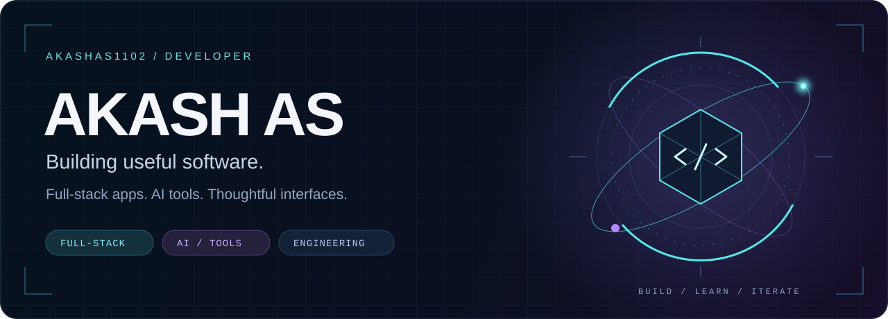

  

  <strong>Full-stack development · AI experiments · Thoughtful interfaces</strong> 
  Turning practical problems into software, one project at a time.

  <a href="#selected-projects">Explore projects</a> &nbsp; / &nbsp;
  <a href="#toolkit">View toolkit</a> &nbsp; / &nbsp;
  <a href="mailto:akashasakash3@gmail.com">Get in touch</a>

---

## About me

I'm **Akash AS**, an engineering student building web applications, dashboards, and AI-powered tools. My work spans railway reservations, clinic workflows, agriculture insights, and everyday productivity. I also practice data structures and algorithms in Java, Python, C, and TypeScript.

## Selected projects

<table>
<tr>
<td width="50%" valign="top">

### 01 / RailAurum

Railway reservation app with train search, fare comparison, seat booking, and PNR e-tickets.

**React · TypeScript · Spring Boot · PostgreSQL**

[Explore code](https://github.com/AkashAS1102/railaurm) · [Open demo](https://railaurm.vercel.app)

</td>
<td width="50%" valign="top">

### 02 / Aarogya

Hospital and clinic management system covering patient registration, consultations, pharmacy, and administration.

**React · Java / Node.js · SQLite**

[Explore code](https://github.com/AkashAS1102/clinic1)

</td>
</tr>
<tr>
<td width="50%" valign="top">

### 03 / AgroSense

Agriculture dashboard bringing together crop recommendations, weather, disease scanning, and market information.

**React · TypeScript · Python · FastAPI**

[Explore code](https://github.com/AkashAS1102/agri-dashboard) · [Open demo](https://agri-dashboard-tan.vercel.app)

</td>
<td width="50%" valign="top">

### 04 / Personal Expense Manager

Finance dashboard with expense entry, category totals, and a visual breakdown of spending.

**JavaScript · Node.js · Chart.js**

[Explore code](https://github.com/AkashAS1102/Personal-Expense-Manager) · [Open demo](https://personal-expense-manager-pi.vercel.app)

</td>
</tr>
<tr>
<td width="50%" valign="top">

### 05 / AI Study Companion

Study companion focused on learning, revision, and student productivity.

**JavaScript · HTML · CSS**

[Explore code](https://github.com/AkashAS1102/ai-study-companion)

</td>
<td width="50%" valign="top">

### 06 / DSA practice

Algorithm practice and problem-solving exercises across languages.

**Java · Python · C · TypeScript**

[LeetCode solutions](https://github.com/AkashAS1102/leetcode-solutions) · [TypeScript practice](https://github.com/AkashAS1102/dsa-practice-typescript)

</td>
</tr>
</table>

## Toolkit

| Area | Technologies I work with |
| :--- | :--- |
| Languages | JavaScript, TypeScript, Python, Java, C |
| Interfaces | HTML, CSS, React, Next.js, Vite, Tailwind CSS |
| APIs & data | Node.js, Express, Spring Boot, FastAPI, PostgreSQL, SQLite, Supabase |
| Workflow | Git, GitHub, VS Code |

## Connect

Have an idea involving useful web apps, AI tools, or dashboards? Let's talk.

[Email](mailto:akashasakash3@gmail.com) · [GitHub](https://github.com/AkashAS1102) · [Browse all repositories](https://github.com/AkashAS1102?tab=repositories)

  

