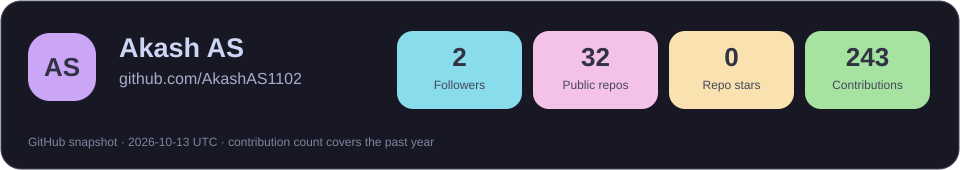
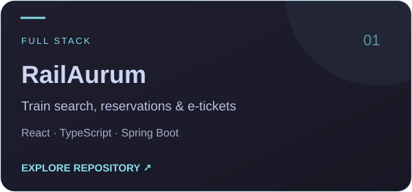
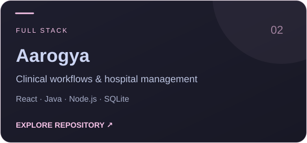
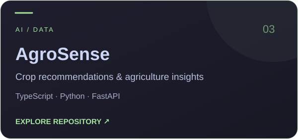
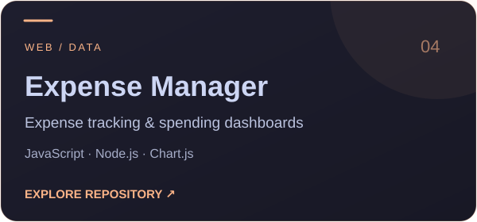
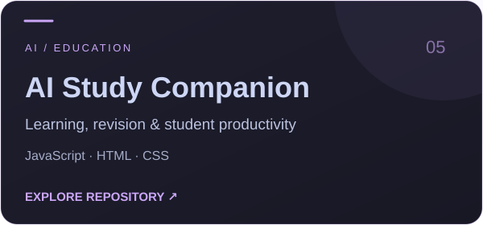
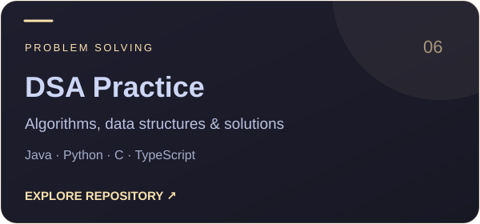
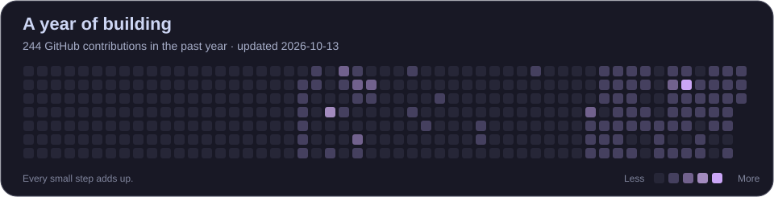
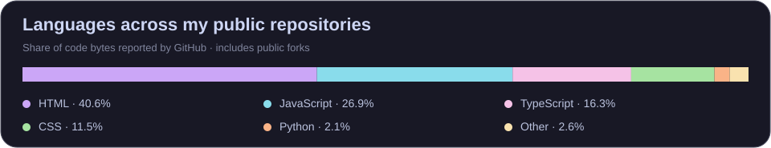

<div align="center">
  
  <br />
  
  <br /><br />
  <a href="mailto:akashasakash3@gmail.com"></a>
  <a href="https://github.com/AkashAS1102"></a>
  <a href="#projects"></a>
  <br /><br />
  <strong>From thoughtful interfaces to intelligent applications.</strong>
</div>

## 👻 A little about me...

<p align="center">
  <a href="https://github.com/AkashAS1102"></a>
</p>

I'm **Akash AS**, a **Full Stack Engineer & AI Engineer**. I build web applications, APIs, dashboards, and AI-powered tools that solve practical problems.

My projects bring together frontend interfaces, backend services, and data — from railway reservations and clinic management to crop recommendations and student productivity. I enjoy connecting useful ideas with clear, usable software.

I keep sharpening my problem-solving skills through data structures and algorithms, while exploring machine learning and building new applications.

```javascript
const akash = {
  name: "Akash AS",
  role: ["Full Stack Engineer", "AI Engineer"],
  languages: ["JavaScript", "TypeScript", "Python", "Java", "C"],
  engineering: {
    frontend: ["React", "Next.js", "HTML", "CSS", "Tailwind CSS"],
    backend: ["Node.js", "Express", "Spring Boot", "FastAPI"],
    databases: ["PostgreSQL", "SQLite", "Supabase"],
    ai: ["scikit-learn", "NumPy", "AI-powered applications"],
    tools: ["Git", "GitHub", "VS Code", "Vite"]
  },
  interests: ["AI tools", "Full-stack apps", "Dashboards", "Automation"],
  mindset: "Create. Connect. Keep building."
};
```

<a name="projects"></a>

## 🚀 Selected projects (clickable)

<p>Explore the repositories behind my full-stack applications, AI tools, and problem-solving work.</p>

<table>
<tr>
<td width="50%" align="center">
  <a href="https://github.com/AkashAS1102/railaurm"></a>
  <br /><a href="https://railaurm.vercel.app">Open demo ↗</a>
</td>
<td width="50%" align="center">
  <a href="https://github.com/AkashAS1102/clinic1"></a>
  <br /><a href="https://github.com/AkashAS1102/clinic1">Explore code ↗</a>
</td>
</tr>
<tr>
<td width="50%" align="center">
  <a href="https://github.com/AkashAS1102/agri-dashboard"></a>
  <br /><a href="https://agri-dashboard-tan.vercel.app">Open demo ↗</a>
</td>
<td width="50%" align="center">
  <a href="https://github.com/AkashAS1102/Personal-Expense-Manager"></a>
  <br /><a href="https://personal-expense-manager-pi.vercel.app">Open demo ↗</a>
</td>
</tr>
<tr>
<td width="50%" align="center">
  <a href="https://github.com/AkashAS1102/ai-study-companion"></a>
  <br /><a href="https://github.com/AkashAS1102/ai-study-companion">Explore code ↗</a>
</td>
<td width="50%" align="center">
  <a href="https://github.com/AkashAS1102/leetcode-solutions"></a>
  <br /><a href="https://github.com/AkashAS1102/dsa-practice-typescript">TypeScript practice ↗</a>
</td>
</tr>
</table>

<p align="center"><a href="https://github.com/AkashAS1102?tab=repositories"><strong>Browse all my repositories →</strong></a></p>

## 📊 GitHub statistics

<details open>
<summary><strong>Activity & language breakdown</strong></summary>
<br />
<p align="center">
  
  <br /><br />
  
</p>

<sub>Cards refresh weekly from GitHub. Language percentages describe repository code, including public forks.</sub>

</details>

## 💬 Let's connect

Interested in full-stack applications, AI-powered tools, or a useful new idea? Reach me at **[akashasakash3@gmail.com](mailto:akashasakash3@gmail.com)**.

<p align="center">
  
</p>
